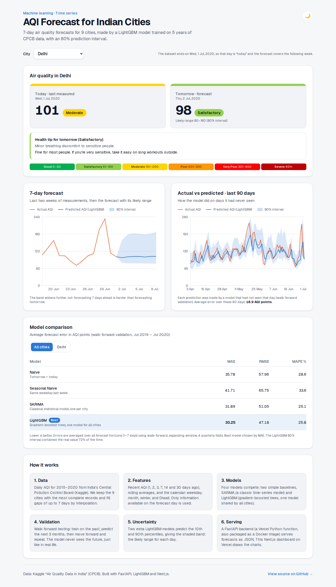
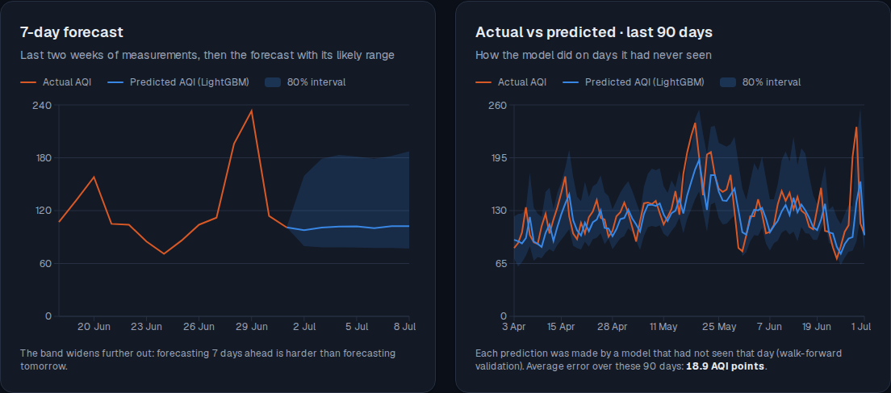
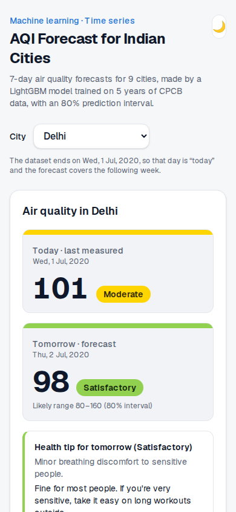
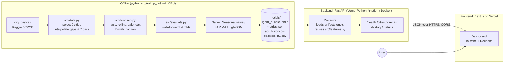

# AQI Forecast for Indian Cities

7-day air quality (AQI) forecasts for 9 Indian cities, with prediction intervals. End-to-end project covering EDA, time-series modelling, a FastAPI backend and a Next.js dashboard, all deployed. Runs on CPU only.

**Live demo:** [aqi-forecast-eta.vercel.app](https://aqi-forecast-eta.vercel.app) · **API:** [aqi-forecast-api.vercel.app/docs](https://aqi-forecast-api.vercel.app/docs)

> The API runs as a serverless function. The first request after it has been idle takes ~7 s (cold start), then ~0.5 s.



<p align="center">
  
  
</p>

---

## Problem statement

Air pollution is a major health risk in Indian cities. Winter AQI in Delhi regularly reaches "Very Poor" or "Severe". A reliable forecast a few days ahead lets people plan outdoor activity and lets sensitive groups take precautions.

**Goal:** given a city's AQI history up to today, predict daily AQI for each of the next 7 days, with an uncertainty range. Show it in a simple web app.

## Dataset

[Air Quality Data in India (2015–2020)](https://www.kaggle.com/datasets/rohanrao/air-quality-data-in-india) on Kaggle, file `city_day.csv`. It has daily pollutant readings (PM2.5, PM10, NO2, ...) and AQI from Central Pollution Control Board (CPCB) stations: about 29.5k rows, 26 cities, Jan 2015 – Jul 2020.

- **City selection:** at least 1100 days with AQI and at least 75% coverage. That gives **Delhi, Bengaluru, Lucknow, Chennai, Hyderabad, Patna, Gurugram, Visakhapatnam and Amritsar**, which covers north, south and east India and both very polluted and fairly clean cities.
- **Missing values:** time-based interpolation for gaps of **up to 7 days only**. Longer gaps (for example, the 6-month outages in Patna and Visakhapatnam) stay empty, because a straight line across months would invent data.
- **Data ends on 2020-07-01**, so the app treats that day as "today" and forecasts 2–8 July 2020.

## EDA insights

Full analysis: [`notebooks/eda.ipynb`](notebooks/eda.ipynb)

| Finding | What it means for the model |
|---|---|
| **North India is ~2× more polluted** (Delhi ≈259 average AQI vs Bengaluru ≈94), but every city has the same yearly shape | One **global model** with city as a feature |
| **Winter AQI ≈ 2× monsoon AQI** (≈239 vs ≈115): temperature inversions, low wind, stubble burning; rain cleans the air | `month`, `day_of_year`, `is_winter` |
| **Strong autocorrelation:** 0.82 at lag 1, 0.53 at lag 7, 0.37 at lag 30 | Lag and rolling-window features |
| **Diwali:** AQI peaks the **day after** (+45% on average, +207% in Visakhapatnam) because CPCB AQI is a 24-hour average | Diwali / post-Diwali / ±3-day flags |
| **Weekday effect** is small (a few %) | `day_of_week` (it costs nothing to add) |
| **COVID lockdown (Mar–May 2020):** AQI ~38% lower than the same weeks of 2019 | Validation includes 2020 to test robustness |
| PM10 (0.90) and PM2.5 (0.88) correlate most with AQI | **Not used**: next week's PM2.5 is unknown at forecast time |

## Feature engineering

The model uses a **direct multi-horizon** setup. For every city and every forecast day *t*, there are 7 rows, one per horizon *h* = 1…7, each meaning "predict AQI on day *t + h* using only what was known at the end of day *t*."

| Group | Features | Known at forecast time? |
|---|---|---|
| Lags | AQI 1, 2, 3, 7, 14, 30 days back | ✅ uses data ≤ *t* only |
| Rolling | mean and std over 7, 14, 30 days | ✅ window ends at *t* |
| Relative | each lag/rolling value ÷ today's AQI | ✅ |
| Calendar (of the target day) | day of week, month, day of year, is_winter | ✅ the calendar is known in advance |
| Festival (of the target day) | is_diwali, is_post_diwali, near_diwali (±3 days) | ✅ Diwali dates are known in advance |
| Other | horizon *h*, city (categorical) | ✅ |

**No leakage:** same-day pollutants are never used, and every lag or rolling window ends at the forecast day.

## Models and validation

| Model | Idea |
|---|---|
| **Naive** | Every future day = today's AQI |
| **Seasonal naive** | AQI on the target day = AQI on the same weekday last week |
| **SARIMA** (1,1,1)(1,0,1)[7] | Classical statistical model, one per city, on log(1 + AQI) |
| **LightGBM** | Gradient-boosted trees, **one global model** for all cities. Predicts the *relative change* log(AQI[t+h] / AQI[t]) with an L1 (MAE) loss. Two extra models with quantile loss (α = 0.1 and 0.9) give the **80% prediction interval** |

**Walk-forward validation**, never a random split. There are 4 quarterly folds, Jul 2019 → Jul 2020, with an expanding window: train on everything before the quarter, predict the quarter, move on. Test set: 22,365 forecasts (9 cities × ~366 days × 7 horizons).

### Results: overall (all cities, horizons 1–7)

| Model | MAE ↓ | RMSE ↓ | MAPE % ↓ |
|---|---:|---:|---:|
| Naive | 35.78 | 57.96 | 28.65 |
| Seasonal naive | 41.71 | 65.75 | 33.60 |
| SARIMA | 31.89 | 51.05 | **25.14** |
| **LightGBM** ⭐ | **30.25** | **47.18** | 25.84 |

**LightGBM has the lowest MAE and RMSE:** 15% lower MAE than naive and 5% lower than SARIMA.

### Where LightGBM wins (and where it doesn't)

| | Naive | SARIMA | LightGBM |
|---|---:|---:|---:|
| **Winter fold** (Oct–Dec 2019), MAE | 59.58 | 56.57 | **49.28** (−13% vs SARIMA) |
| **Delhi**, MAE | 57.94 | 52.46 | **46.19** (−12%) |
| **7 days ahead**, MAE | 41.82 | 36.41 | **34.00** (−19% vs naive) |
| **1 day ahead**, MAE | 21.25 | **21.19** | 21.35 |

- LightGBM wins in the polluted northern cities (Delhi, Gurugram, Lucknow, Patna, Amritsar) and in winter, where the seasonal and Diwali features matter most. Large errors happen there, so these wins dominate the overall score.
- SARIMA is slightly better in the cleaner southern cities (Bengaluru, Chennai, Hyderabad, Visakhapatnam) and on MAPE, but the gap is about 1 AQI point or less in all four (0.05–1.01).
- For **tomorrow**, "same as today" is nearly impossible to beat. The models pull ahead from day 2 onwards.
- **Prediction interval:** the nominal 80% band contained the real value **72%** of the time, so it is somewhat too narrow, mostly because of sudden spikes such as Diwali and the lockdown. See *Future improvements*.

Per-city, per-horizon and per-fold metrics are in [`models/metrics.json`](models/metrics.json).

## Architecture



**Train/serve consistency:** the API imports the same `src/features.py` used in training, so features are computed exactly the same way when serving.

## API

| Endpoint | Returns |
|---|---|
| `GET /health` | status, model name, data end date |
| `GET /cities` | the 9 modelled cities |
| `GET /forecast?city=Delhi&days=7` | dates, predicted AQI, lower/upper (80%), CPCB category |
| `GET /history?city=Delhi&days=90` | actual vs out-of-sample predicted AQI (from walk-forward validation) |
| `GET /metrics` | model comparison table, overall and per city |

Input validation: `days` must be 1–7 for forecasts and 1–365 for history. City names are case-insensitive; an unknown city returns 404 with the list of valid ones. Interactive docs are at [`/docs`](https://aqi-forecast-api.vercel.app/docs).

AQI categories follow the CPCB standard: Good 0–50, Satisfactory 51–100, Moderate 101–200, Poor 201–300, Very Poor 301–400, Severe 401+.

## Tech stack

| Layer | Tools |
|---|---|
| Data and EDA | pandas, NumPy, Matplotlib, seaborn, Jupyter |
| Modelling | LightGBM (point and quantile), statsmodels SARIMAX, scikit-learn, joblib |
| Backend | FastAPI, Pydantic, Uvicorn, pytest (26 tests), Docker |
| Frontend | Next.js 15 (App Router), TypeScript, Tailwind CSS v4, Recharts, next-themes |
| Deployment | Vercel (Python function for the API, Next.js for the frontend) |

## Run locally

Requirements: Python 3.13, Node 20+, and the Kaggle CSV saved as `data/city_day.csv`.

```bash
# 1. Python environment
python3.13 -m venv .venv
.venv/bin/pip install -r requirements.txt

# 2. (Optional) re-run EDA and re-train. The trained models are already in models/
.venv/bin/jupyter nbconvert --to notebook --execute --inplace notebooks/eda.ipynb
.venv/bin/python src/train.py

# 3. Backend on http://localhost:7860  (docs at /docs)
.venv/bin/uvicorn backend.app.main:app --reload --port 7860
.venv/bin/pytest                                  # run the API tests

# 4. Frontend on http://localhost:3000
cd frontend
npm install
echo "NEXT_PUBLIC_API_URL=http://localhost:7860" > .env.local
npm run dev
```

**Docker** (the image also works on Hugging Face Spaces, port 7860):

```bash
docker build -f backend/Dockerfile -t aqi-api .
docker run -p 7860:7860 aqi-api
```

**Deploy:** see `deploy/build_vercel_api.sh` (API on Vercel) and `deploy/deploy_hf.py` (Hugging Face Docker Space, which needs a PRO account).

## Project structure

```
├── data/                 raw Kaggle CSV (gitignored)
├── notebooks/eda.ipynb   exploratory analysis
├── src/                  config, data cleaning, features, models, evaluation, train.py
├── models/               trained LightGBM bundle, metrics.json, data the API needs
├── backend/              FastAPI app, tests, Dockerfile
├── frontend/             Next.js dashboard
├── deploy/               deployment scripts (Vercel, Hugging Face)
└── docs/screenshots/
```

## Future improvements

- **Live data:** pull recent readings from the CPCB / OpenAQ API and re-forecast daily, instead of a static dataset that ends in 2020.
- **Weather features:** wind speed, temperature, humidity and rainfall forecasts drive pollution (inversions, washout) and should help most at longer horizons.
- **Better-calibrated intervals:** use conformal prediction to bring the 80% band from 72% coverage up to the nominal 80%.
- **More festival and event features:** Holi, stubble-burning season intensity (fire counts from satellite data), and other holidays.
- **Hyperparameter tuning** with time-series cross-validation (e.g. Optuna), and an ensemble of SARIMA and LightGBM, since each wins in different cities.
- **Monitoring:** log live forecast errors and alert on drift, with scheduled retraining.

## Resume bullets

- Built an end-to-end **AQI forecasting system** for 9 Indian cities (5 years of CPCB data). A global **LightGBM** model with lag, rolling, seasonal and Diwali features reduced 7-day forecast **MAE by 15% vs a naive baseline and 5% vs SARIMA** (30.25 vs 35.78 / 31.89), and by **13% vs SARIMA in the winter pollution season**, under leakage-free walk-forward validation over 22k forecasts.
- Added **uncertainty estimates** with LightGBM quantile regression (10th/90th percentiles) and served forecasts, history and model metrics through a **FastAPI** REST API with Pydantic validation, **26 pytest tests** and a Docker image, deployed as a serverless Python function on Vercel.
- Developed a responsive **Next.js + TypeScript + Tailwind + Recharts** dashboard with CPCB-colour-coded AQI cards and health tips, 7-day forecast charts with confidence bands, actual-vs-predicted backtests and a model comparison table, with dark mode; deployed on Vercel ([live demo](https://aqi-forecast-eta.vercel.app)).
